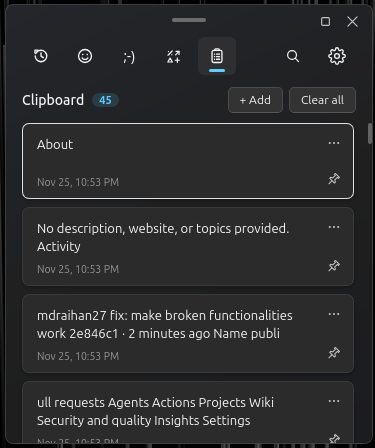
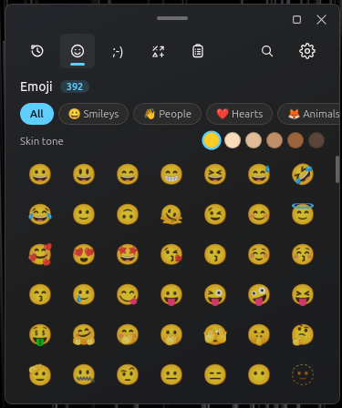
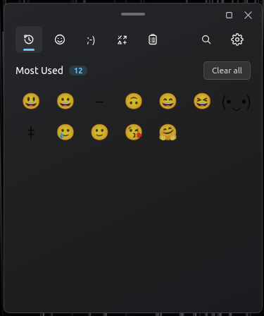
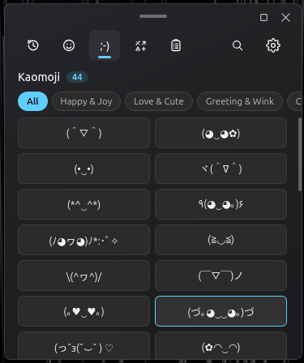
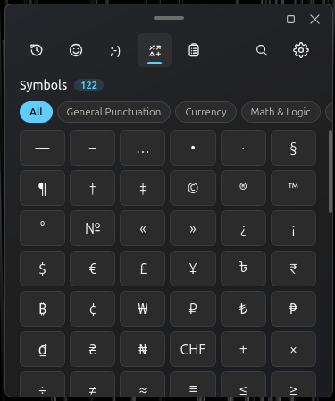
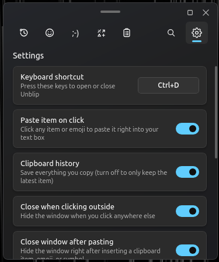
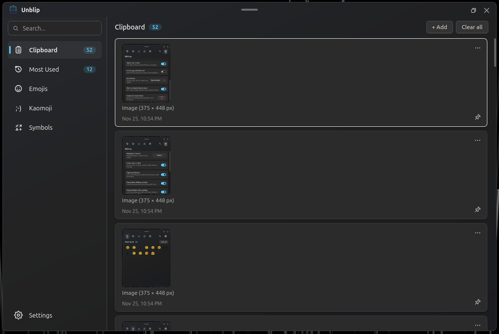
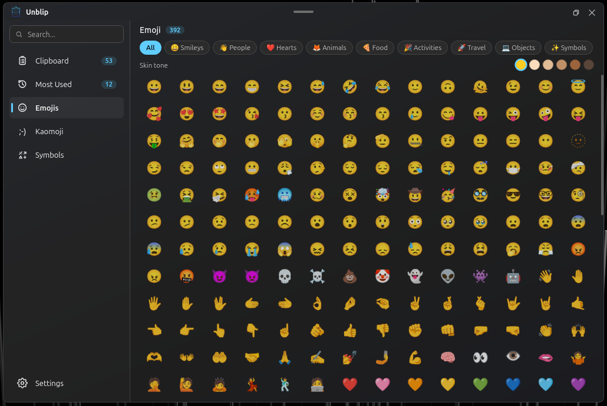
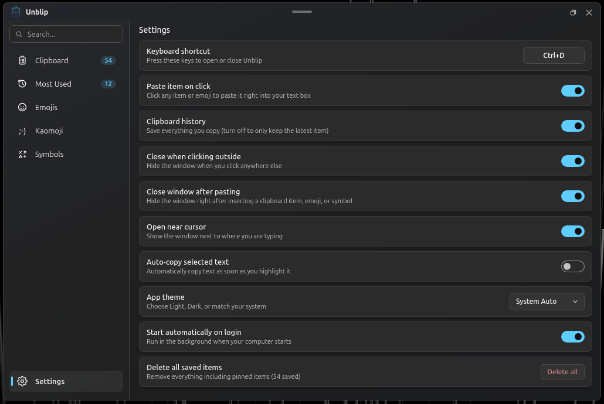

<div align="center">
  
  <h1>Unblip</h1>
  <p><strong>Windows 11 Clipboard History, Emoji, Kaomoji & Symbols Manager for Linux — but better.</strong></p>
  <p>
    Built with Rust &amp; Tauri v2 for Ubuntu and Linux desktops (Wayland &amp; X11).
  </p>
</div>

---

## Overview

**Unblip** brings the familiar Windows 11 (`Win+V`) clipboard and emoji popup to Linux, redesigned to be faster, smarter, and more flexible:

- **Works like Windows 11 Clipboard — and goes further**: Press `Super+V` (or your own custom shortcut) anywhere to open a lightweight `368 × 440` popup right next to your active text cursor, or click **Maximize** (`□`) to expand into a full-size desktop workspace with a sidebar.
- **Direct Paste Without Stealing Focus**: Click any emoji, kaomoji, symbol, or clipboard item to insert it straight into your active text box (via IBus on Wayland &amp; X11) without losing cursor focus or triggering permission popups.
- **Smart Clipboard History**: Automatically tracks text, URLs, hex/RGB color swatches, code snippets, and copied images with dimensions, timestamps, pinning, manual `+ Add`, and instant search (`Ctrl+F`).
- **Most Used Matrix**: Keeps your top 2 rows of frequently used emojis, kaomoji, and symbols one click away.

---

## Screenshots

### Compact Popup

<table>
  <tr>
    <td align="center"><strong>Clipboard History</strong></td>
    <td align="center"><strong>Emojis &amp; Skin Tones</strong></td>
    <td align="center"><strong>Most Used</strong></td>
  </tr>
  <tr>
    <td></td>
    <td></td>
    <td></td>
  </tr>
  <tr>
    <td align="center"><strong>Kaomoji</strong></td>
    <td align="center"><strong>Symbols</strong></td>
    <td align="center"><strong>Settings</strong></td>
  </tr>
  <tr>
    <td></td>
    <td></td>
    <td></td>
  </tr>
</table>

### Expanded Window Mode

<p align="center">
  
</p>
<p align="center">
  
</p>
<p align="center">
  
</p>

---

## Extra Features & Settings

Unblip includes granular controls beyond the standard Windows clipboard popup:

| Setting | Description |
| --- | --- |
| **Keyboard shortcut** | Record any custom global shortcut (defaults to `Super+V`, syncs automatically with GNOME shortcuts). |
| **Paste item on click** | Insert the clicked clipboard item, emoji, kaomoji, or symbol directly into your active text box. |
| **Clipboard history** | Master toggle to save full copy history, or turn off to only keep the single latest copied item. |
| **Close when clicking outside** | Automatically hide Unblip when you click anywhere outside the window. |
| **Close window after pasting** | Choose whether Unblip hides immediately after inserting an item or stays open for multi-pasting. |
| **Open near cursor** | Position the popup beside your active text cursor without covering the input box. |
| **Auto-copy selected text** | Automatically copy text to your clipboard as soon as you highlight it. |
| **App theme** | Switch between **Light**, **Dark**, or **System Auto** Fluent UI themes. |
| **Start automatically on login** | Run silently in the background/system tray at boot so your shortcut is always ready. |
| **Delete all saved items** | Wipe all stored clipboard items, including pinned items, in one click. |

---

## Installation

Pre-built packages are available in [`Releases`](https://github.com/mdraihan27/unblip/releases):

To uninstall:
```bash
sudo apt remove unblip
```
*(Or remove **Unblip** directly from the Ubuntu App Store under **Installed Apps**.)*

### Other Linux Formats
- **AppImage**: `chmod +x installables/Unblip-1.0.5-x86_64.AppImage && ./installables/Unblip-1.0.5-x86_64.AppImage`
- **Universal Installer (`.run`)**: `chmod +x installables/unblip-1.0.5-linux-x86_64.run && ./installables/unblip-1.0.5-linux-x86_64.run`
- **Snap**: `sudo snap install --dangerous --classic installables/unblip_1.0.5_amd64.snap`
- **Arch Linux**: `sudo pacman -U installables/unblip-1.0.5-1-x86_64.pkg.tar.zst`

---

## Development

```bash
# Install frontend dependencies
npm install

# Run unit tests
cd src-tauri && cargo test

# Build frontend & release binary
npm run build && cd src-tauri && cargo build --release
```

---

<p align="center">
  Developed by <a href="https://raihanhossen.work"><strong>Raihan Hossen</strong></a>
</p>

